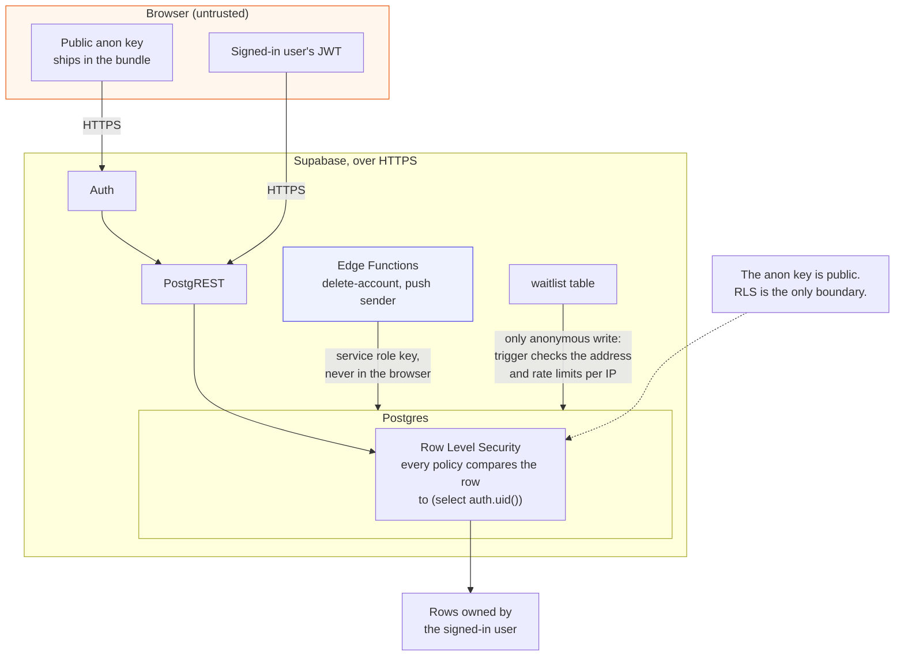

# Security policy

## Reporting a vulnerability

Use the **Report a vulnerability** button on this repository's Security tab to
open a private advisory, or contact the maintainer through the profile linked on
the repository page. Please do not open a public issue for anything exploitable.

A useful report says what you did, what happened, and what you expected
instead. A minimal reproduction helps more than a long write-up.

## What is in scope

- Row Level Security gaps that let one account read or write another account's
  rows.
- Authentication flows: sign-up, email confirmation, password reset, session
  handling.
- Cross-site scripting in user-supplied content, such as appliance names,
  notes, and addresses.
- The service worker and the push subscription flow.
- Content Security Policy or header weaknesses in `vercel.json`.

## How the app protects data

- **The Supabase anon key is public.** It is meant to ship to browsers and it
  is present in every deployed bundle. On its own it grants no access.
- **Row Level Security is the boundary.** Every table has RLS enabled, and a
  request that carries only the anon key reads nothing. You can confirm this
  yourself against the demo instance:

  ```
  curl "https://dtiesmtanetxhyryxzbu.supabase.co/rest/v1/appliances?select=*" \
    -H "apikey: <anon key>"
  # []
  ```

- **Write paths that need an account check for one themselves.**
  `attempt_join_household` and `regenerate_invite_code` run as the function
  owner, validate the caller with `auth.uid()`, and are not executable by
  `anon` at all.
- **The waitlist is the only table anybody can write to, and it is guarded.**
  Addresses are trimmed, lowercased and shape checked, and a client can add ten
  before an hour passes. The count is kept against the address the edge saw, not
  one the caller sent.
- **The schema and its policies are in the repository** under
  `supabase/migrations/`, so they can be reviewed and tested instead of taken
  on trust. Nothing in them is a credential.
- **The service role key is never in this repository.** It bypasses RLS, so it
  belongs only in server-side environments such as a Supabase edge function.
- Security headers and a Content Security Policy are set in `vercel.json`.

The shape of it, with the browser treated as untrusted and the database as the
only thing that decides:



## Out of scope

- Anything that requires the service role key.
- Resource exhaustion against Supabase free-tier quotas.
- Vulnerabilities in development-only dependencies that have no reachable path
  in a production bundle.
